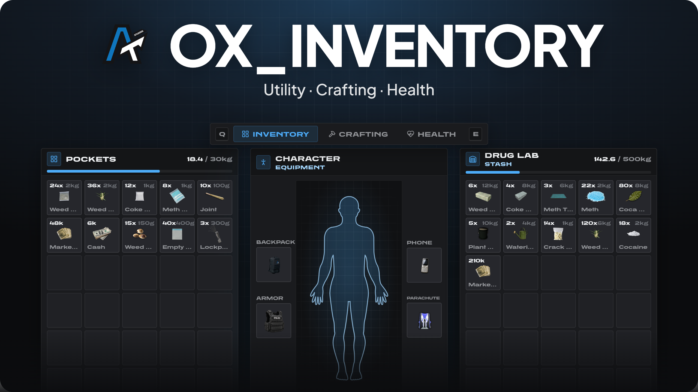
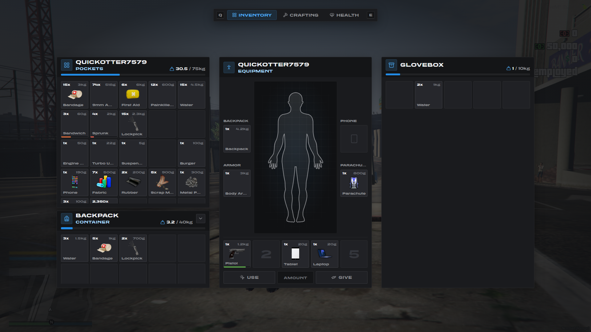
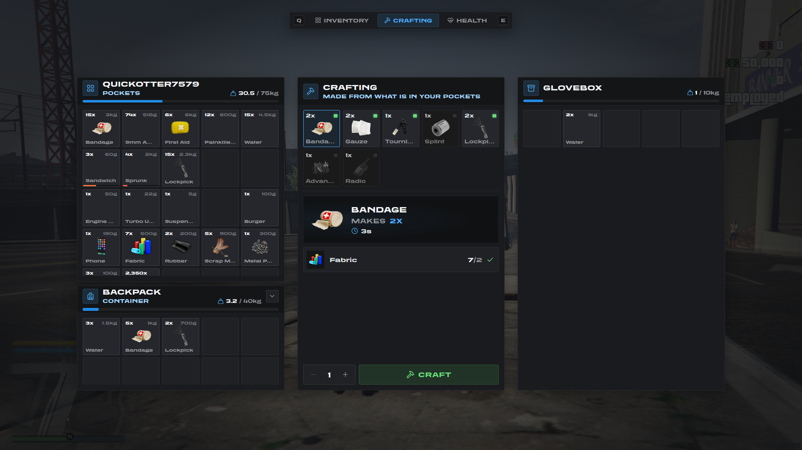
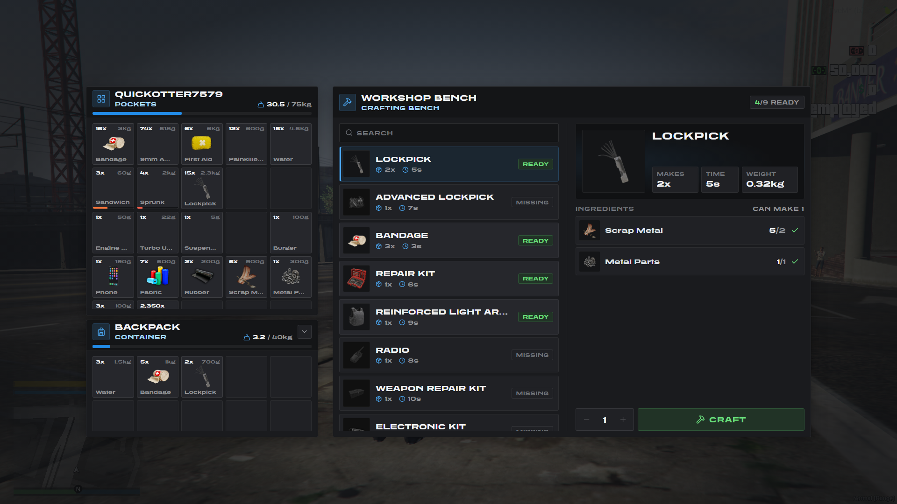
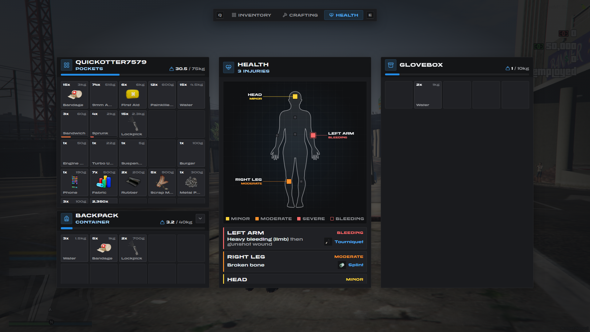
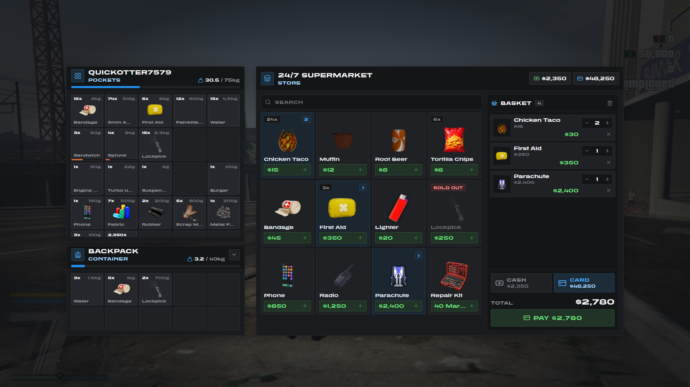

# ox_inventory, redesigned for Qbox

**Preview video:** [watch on YouTube](https://www.youtube.com/watch?v=rgmuzJRm_uU)

A redesigned ox_inventory for Qbox servers. It keeps everything the original inventory does and adds a three-column layout with Inventory, Crafting and Health tabs, equipment slots for a backpack, armour, phone and parachute, worn backpacks with a prop on the player, armour that lives in the vest item, crafting from anywhere, a new crafting station view and a shop with a basket and Cash or Card payment.

This is a fork of [ox_inventory](https://github.com/overextended/ox_inventory) by [Overextended](https://github.com/overextended), version 2.48.1. All of the core inventory, item, stash, shop and weapon logic is their work. Please support the original project, and read its [documentation](https://overextended.dev/docs/ox_inventory) for everything this README does not cover.

## Features

### Three-column layout with tabs

The inventory opens as three columns. Your pockets sit on the left, the other inventory (ground, glovebox, trunk, stash, shop and so on) sits on the right, and the centre column changes with the selected tab. Press Q and E to step through the Inventory, Crafting and Health tabs, or click a tab in the top bar. Opening a trunk, stash or shop always jumps back to the Inventory tab, while a plain TAB press keeps the tab you picked last.

The Inventory tab shows your character with the equipment slots around it, the five hotkey slots underneath and the Use, amount and Give controls.

### Utility slots

Hotkey slots 1 to 5 sit under the character. By default slots 1 and 2 are weapon slots: they only accept weapons and are marked as such in the UI. You can change which hotkeys are weapon slots, or turn them off, in `data/utility.lua`.

Equipment slots are real player inventory slots reserved at the end of the inventory, so they save, sync and work with every export like any other slot. Each one only accepts the items you list for it. The default set is shown below.

| Slot | Accepts | What it does |
| --- | --- | --- |
| Backpack | `backpack_small`, `backpack_medium`, `backpack_large` | The worn bag. It opens under your pockets and shows a prop on your back. |
| Armor | `lightarmor`, `heavyarmor`, `armor` | The worn vest. Its durability is your armour. |
| Phone | `phone` | Keeps the phone out of the way of the regular slots. |
| Parachute | `parachute` | Keeps the parachute out of the way of the regular slots. |

### Worn backpacks

A bag in the backpack slot is worn. Whenever you open the ground, a glovebox, a trunk or a stash, the bag opens stacked under your pockets in the left column, so you can move items between the bag, your pockets and the other inventory at once. The bag section can be folded down to its header, and the inventory remembers that choice.

While a bag is worn, a prop is attached to the player's back. Each bag item can use its own model, offset and rotation, set in `data/utility.lua`. The resource does not include any prop models, so point the config at models your server streams (or at a base game prop). Bag sizes are set in `modules/items/containers.lua`: the small bag holds 10 slots and 15 kg, the medium bag 20 slots and 30 kg, and the large bag 30 slots and 50 kg. Bags cannot be put inside other bags.

### Vest armour tied to durability

The vest in the armor slot is the player's armour. A fresh vest gives the armour value set for it in `vestArmor` (50 for a light vest, 75 for a heavy vest and 100 for a full vest by default), and the vest's durability bar shows how much is left. When you get shot, the vest wears down to the armour you have left. At zero the vest is destroyed, and if you carry a stack of vests in the slot the next one starts fresh.

Using a vest from your pockets moves it into the armor slot. Taking the vest off removes the armour. The server only ever lowers vest durability, so a client cannot repair its own vest.

### Personal crafting bench

The Crafting tab lets players craft from anywhere using the ingredients in their pockets. Recipes come from the bench named `personal` in `data/crafting.lua`, which has no points or zones, so the player's own position counts as the bench. Each recipe shows its ingredients with what you carry against what it needs, the amount it makes and the time it takes. You can queue a batch of up to 50 crafts. Crafting is blocked while in a vehicle.

### World crafting station view

Crafting benches placed in the world with `points` or `zones` in `data/crafting.lua` open a full crafting station view. It has a searchable recipe list next to the selected recipe, with its yield, craft time, description and ingredient check, and a batch craft button that shows the progress of each item. The station reopens on its own after the crafting progress bar, so you can keep crafting without walking away and back.

### Health tab

The Health tab draws a body figure with a square marker and a callout label on every injured body part, plus a list of the injuries with their severity, whether the part is bleeding and the item that treats it.

The injuries come from [qbx_medical](https://github.com/Qbox-project/qbx_medical), the medical resource that ships with Qbox, so the tab works out of the box. qbx_medical tracks 15 body parts. The tab groups them into seven areas and shows the worst wound in each, for example "Painful (left hand)" on the left arm. qbx_medical keeps one bleed level for the whole body, so bleeding is shown on the most injured area, or on the chest when nothing else is hurt. Bleeding points to the `bandage` item and other wounds to `painkillers`, when those items exist. A player in last stand or dead shows as Unresponsive.

When no supported medical resource is running, the tab shows a short note that injury tracking is not available. You can also turn the tab off, see `tabs` under Configuration.

#### Using another medical script

Set `medical` in `data/utility.lua` to `'rm-medical'`, or leave it on `'auto'`, and the tab calls the client export `exports['rm-medical']:GetInjuries()` instead. Any medical script can feed the tab by using that resource name and returning a list of body parts in this shape.

| Field | Type | Meaning |
| --- | --- | --- |
| `id` | string | Body part id: `head`, `chest`, `abdomen`, `left_arm`, `right_arm`, `left_leg` or `right_leg` |
| `label` | string | Name shown in the UI |
| `severity` | number | 0 for no injury, then 1 to 3 |
| `kind` | string, optional | Injury type, for example `trauma`, `bleeding` or `fracture` |
| `wound` | string, optional | Description of the wound |
| `bleeding` | boolean, optional | Whether the part is bleeding |
| `after` | string, optional | What caused it, for example a gunshot wound |
| `item` | string, optional | Item name that treats it |
| `itemLabel` | string, optional | Label of that item |

### Shop with basket and Cash or Card payment

Shops open in a store view with a searchable product grid and a basket. Add products to the basket, change the amounts, then pay for everything in one go. The header shows the cash you carry and your bank balance.

Pick Cash or Card before paying. Cash uses the `money` item in your pockets, as in the original inventory. Card takes the money from the player's qbx_core bank account. The bank is charged before the item is handed over and refunded if the item cannot be given. Items priced in another currency (for example black money) are always paid with that item.

License, job grade and stock checks work as in the original shops. The `buyItem` event hook also receives a `payment` field that is either `cash` or `card`.

## Requirements

| Resource | Needed | Notes |
| --- | --- | --- |
| [qbx_core](https://github.com/Qbox-project/qbx_core) | Yes | Player data and the bank account for card payments |
| [ox_lib](https://github.com/overextended/ox_lib) | Yes | |
| [oxmysql](https://github.com/overextended/oxmysql) | Yes | |
| OneSync and server artifact 6116 or newer | Yes | Same as the original ox_inventory |
| [ox_target](https://github.com/overextended/ox_target) | Optional | Only when `inventory:target` is enabled |
| [qbx_medical](https://github.com/Qbox-project/qbx_medical) | Optional | Injuries in the Health tab. Comes with Qbox. |

This fork is built and tested on Qbox only. The bridges for other frameworks from the original resource are still in the code, but the card payment relies on qbx_core.

## Installation

| Step | What to do |
| --- | --- |
| 1 | Remove or disable any other copy of ox_inventory. |
| 2 | Download the latest release, or clone this repository, and place the folder in your resources as `ox_inventory`. The folder name must stay `ox_inventory`. |
| 3 | Make sure the items used by the default config exist in `data/items.lua`: the three backpacks, the three vests, `phone`, `parachute` and the ingredients used in `data/crafting.lua`. Remove or rename entries in the config for items your server does not use. |
| 4 | Set the inventory convars in your `server.cfg`, at least `setr inventory:framework "qbx"`. See the original documentation for the full list. |
| 5 | Start the resource after oxmysql, ox_lib and qbx_core, for example with `ensure ox_inventory`. |
| 6 | Set the backpack prop models in `data/utility.lua` to props your server streams. |

The built UI is included in `web/build`, so you only need to build it yourself if you change the files in `web/src`.

## Configuration

The layout and the new features are configured in `data/utility.lua`. The file is also sent to the UI when it loads.

| Option | Default | Description |
| --- | --- | --- |
| `mode` | `'utility'` | `'utility'` gives the three-column layout with tabs, the character panel, weapon slots and equipment slots. `'classic'` keeps the original style: the hotbar is slots 1 to 5, there are no reserved slots and no tabs. |
| `tabs` | `{ crafting = true, health = true }` | Turns the Crafting and Health tabs on or off. With both off, the top bar is hidden and Q and E do nothing, so the inventory opens straight to the three columns. Turning off crafting also blocks the personal bench on the server. Utility mode only. |
| `medical` | `'auto'` | Where the Health tab reads injuries from. `'auto'` uses rm-medical when it runs and qbx_medical otherwise. `'qbx_medical'` or `'rm-medical'` always uses that one. |
| `backpackItems` | three backpacks | Container items treated as a worn bag. In utility mode the bag must sit in the backpack slot. In classic mode the first bag carried anywhere in the pockets is used. |
| `backpackProps` | one entry per bag | Prop shown on the back for each bag item, as `{ model, offset, rotation }`. |
| `backpackBone` | `24818` | Ped bone the prop is attached to (SKEL_Spine3). |
| `backpackOffset` | `vec3(-0.27, -0.17, 0.0)` | Fallback offset for bags without their own. |
| `backpackRotation` | `vec3(0.0, 90.0, 0.0)` | Fallback rotation for bags without their own. |
| `vestArmor` | `{ lightarmor = 50, heavyarmor = 75, armor = 100 }` | Armour a fresh vest of each item gives. Vests not listed give 100. |
| `weaponSlots` | `{ 1, 2 }` | Hotkey slots that only accept weapons. Set to `{}` to let any item go in them. Utility mode only. |
| `equipment` | backpack, armor, phone, parachute | Equipment slots as `{ kind, label, items }`. They are reserved at the end of the player inventory in order, so the last entry uses the very last slot. Utility mode only. |

The number of player slots still comes from the `inventory:slots` convar, so the equipment slots are taken out of that total. If you change the slot count, the equipment slots move with it to the new last slots.

The personal crafting bench and the world stations are set up in `data/crafting.lua`, in the same format as the original resource. The bench named `personal` feeds the Crafting tab.

## Building the UI

The UI is a React app in `web/`. You need Node.js and pnpm.

Install the dependencies once from the `web` folder with `pnpm install`. Then run `pnpm run build`, which type checks the code and writes the result to `web/build`. If you only want to build without the type check, run `node node_modules/vite/bin/vite.js build` from the same folder.

Restart the resource in game after a build to load the new UI. Running `pnpm start` serves the UI in a browser with sample data, which is useful while working on the design.

## Changes from the original

The table below lists where this fork differs from ox_inventory 2.48.1, as the license asks.

| Area | Files |
| --- | --- |
| Layout config and slot rules | `data/utility.lua`, `modules/utility/shared.lua` (new) |
| Worn vest and worn backpack | `modules/utility/client.lua`, `modules/utility/server.lua` (new), `modules/items/client.lua`, `modules/items/containers.lua` |
| Crafting tab, crafting station, Health tab and bank balance callbacks | `client.lua` |
| Card payments in shops | `modules/shops/server.lua` |
| Personal crafting bench, and the server check that blocks it when the Crafting tab is off | `data/crafting.lua`, `modules/crafting/server.lua` |
| New text | `locales/en.json` |
| Redesigned UI | `web/src` and the built files in `web/build` |

## Changelog

See [CHANGELOG.md](CHANGELOG.md).

## License

This project is licensed under the GNU General Public License v3.0 or later, the same as the original. The full text is in [LICENSE](LICENSE), and the original copyright and attribution notices are kept in [NOTICE.md](NOTICE.md).

ox_inventory is made by Overextended and its contributors. The original source code is available at [github.com/overextended/ox_inventory](https://github.com/overextended/ox_inventory).
